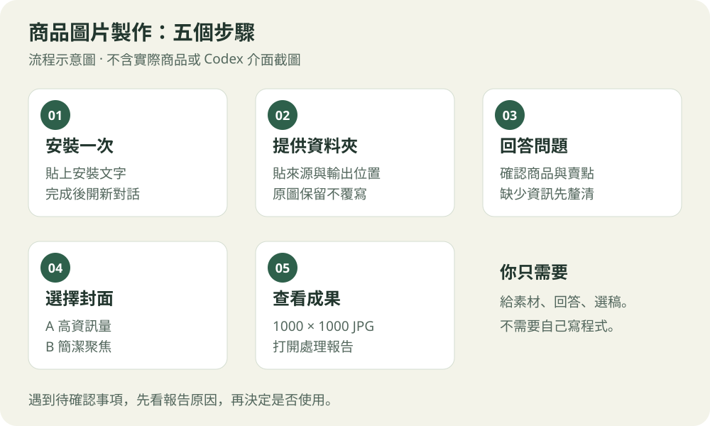

# 商品繁中

給同仁使用的 Codex 技能包。提供商品素材資料夾，由 AI 整理圖片、詢問賣點、製作封面，並處理繁中詳情頁及切片。



## 安裝一次

打開桌面版 Codex，選擇本機執行，將下面整段貼到對話送出：

```text
請使用 $skill-installer，從 GitHub 倉庫 Keith0512/product-image-workflow 的 main 分支，一次安裝這三個技能：
skills/product-image-workflow
skills/product-cover
skills/shopee-image-batch
若有同名技能，先保留並比較差異，不直接覆蓋。完成後請檢查三個技能是否可讀。
```

完成後開新對話；若找不到技能，重新開啟 Codex。

## 更新已安裝的技能

已安裝過的電腦，可在本機執行的 Codex 貼上：

```text
請使用 $skill-installer，將 GitHub Keith0512/product-image-workflow 的 main 最新版更新到本機這三個技能：
skills/product-image-workflow
skills/product-cover
skills/shopee-image-batch
這次已授權更新既有同名技能：先下載到暫存目錄，比較差異，將舊版完整備份到技能掃描範圍以外，再以 main 版本更新；未安裝的就直接安裝。
不要因同名目錄存在就停止，也不要改動其他技能、Codex 設定或商品素材。
完成後檢查三個 SKILL.md、參考文件與腳本可讀，確認已包含「分割前視覺驗收」、check-visual 與 M 切片前阻擋檢查。
回報來源 commit、安裝位置、備份位置與驗證結果；這次只更新技能，不處理商品。
```

更新後下一輪即可使用；若仍看不到更新，重新開啟 Codex。GitHub `main` 更新不會自動替換其他電腦的本機技能，需各自執行更新。[技能安裝與變更偵測說明](https://learn.chatgpt.com/docs/build-skills)

## 每次使用

將下面的來源路徑換成你的資料夾，整段貼到 Codex：

```text
請使用「商品繁中」技能（$product-image-workflow）完整製作商品圖片。
來源目錄：D:\商品素材\商品A
先讀主圖、詳情圖、規格圖與選項圖，再集中問我必要問題。
封面請提供高資訊量與簡潔兩個方向，等我選稿。
封面與主圖交付 1000 × 1000 JPG，保留所有原始素材。
```

資料夾名稱不用完全一致；沒有選項圖或規格圖，就直接告訴 AI。

主圖與詳情整理好後，AI 必須先逐張檢查字體大小、排版，以及不該有的陰影、鬼影、殘影；有問題先修正並重新檢查。全部通過後才製作 S／M 詳情切片，改圖後需重新驗收；紀錄與修正前後對照會放進處理報告。這是 AI 的必要檢查，不需要你每張例行確認。

預設將所有成品、草稿、中間檔及報告存入 `D:\商品素材\商品A\輸出\YYYYMMDD-v01\`；日期採使用者時區，同日再次製作使用 v02、v03，保留原圖與歷史版本。需要另存時，再指定輸出位置。

需要浮水印時，啟動時一併提供圖檔或本機路徑，透明 PNG 優先。每個指定浮水印各做一套主圖（預設包含封面），右下角優先並避開重要內容，先各看一張樣張再整批套用。無浮水印版保留在 `1_主圖`，各套放 `7_浮水印主圖/店家或品牌名稱/`；也可指定只套封面。未提供浮水印就沿用一般流程。

**第一次使用請看 [圖文操作說明](docs/quickstart.md)。** 不需自行寫程式；AI 會先檢查工具，缺少能力時須回報。

## 套件分工

| 中文名稱 | 技能識別名稱 | 工作 |
|---|---|---|
| 商品繁中 | `product-image-workflow` | 統一入口、共用問答、串接與整合交付 |
| 商品封面 | `product-cover` | 商品封面提案、選稿、製作與目視檢查 |
| 商品圖批次處理 | `shopee-image-batch` | 原圖繁中化、詳情頁還原／切割與報告 |

可單獨指定「只做封面」「只做批次圖片」或「只重做 M 版」。M 版是固定高度的詳情切片名稱，不代表 momo 平台規範。

## 使用條件

- 使用能讀寫本機資料夾、檢視圖片及執行程式的 Codex 環境。封面還需要生圖能力；完整繁中處理需要 OCR、字型、排版及背景修復工具。
- 技能不附模型、API 金鑰或 OCR 服務。批次腳本需要 Python 3.10+ 與 Pillow；必要時請 Codex 在專用環境準備，避免改動共用環境。
- 安裝需要 GitHub 網路連線；生圖及部分 OCR 工具可能需要網路。技能不會自動上架，也不會自動把素材推送到 GitHub。素材是否傳送至 AI 服務，依實際使用工具而定。
- 沒有通過文字、外觀與檔案檢查的圖片，不得當作完成品。

本倉庫供同仁取得與安裝，暫未提供開源授權。商品原圖、手作封面與實際處理成果均不隨套件公開。
