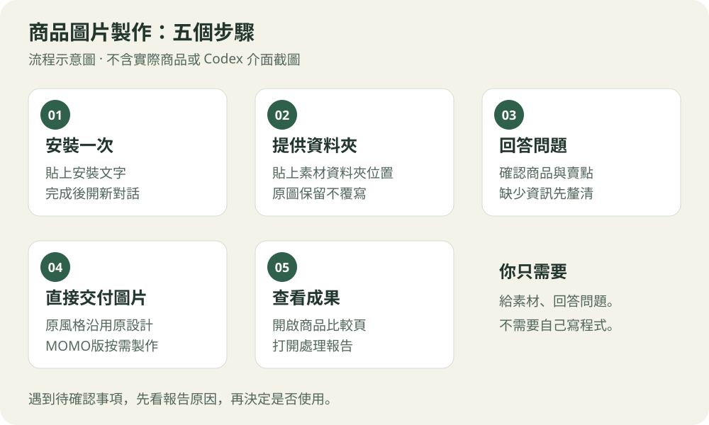

# 商品繁中

給同仁使用的 Codex 技能包。提供商品素材資料夾，由 AI 整理圖片、集中詢問必要資訊，再交付主圖、完整繁中詳情及最多 12 張的蝦皮 S 詳情。M 詳情與 MOMO 封面各自按需製作。

預設採原風格繁中，包含原首圖在內，只在原有文字區換成台灣繁中並保留版面。明確要求時可採「繁中重設計」，重新安排整套圖文與情境。以戶外商品為主，兼顧旅遊及潮流 3C。兩種模式都保留商品事實及完整實質資訊。

每個商品的 `商品名稱_主圖詳情頁差異預覽.html` 集中存放在本次輸出版本目錄。從原圖、原風格繁中、繁中重設計中任選兩項並排，可切換主圖與詳情、獨立捲動、跳圖及縮放。本次只做一套時，系統會搜尋同商品最近一次已驗收、分類相容的另一套成果，並標明來源版本。整份成果資料夾可離線開啟。



## 安裝一次

打開桌面版 Codex，選擇本機執行，將下面整段貼到對話送出：

```text
請使用 $skill-installer，從 GitHub 倉庫 Keith0512/product-image-workflow 的 main 分支，一次安裝這三個技能：
skills/product-image-workflow
skills/product-cover
skills/shopee-image-batch
若有同名技能，先保留並比較差異，不直接覆蓋。完成後請檢查三個技能是否可讀。
```

完成後開新對話；若找不到技能，重新開啟 Codex。

## 更新已安裝的技能

已安裝過的電腦，可在本機執行的 Codex 貼上：

```text
請使用 $skill-installer，將 GitHub Keith0512/product-image-workflow 的 main 最新版更新到本機這三個技能：
skills/product-image-workflow
skills/product-cover
skills/shopee-image-batch
這次已授權更新這三個既有同名技能。先確認 GitHub main 的 commit SHA，以該 SHA 將三個技能下載到暫存目錄。檢查三份 SKILL.md 與支援檔案，再把既有版本完整備份到技能掃描範圍以外，將這三個技能換成該 SHA 的內容。
尚未安裝的技能直接安裝。這次更新範圍限於上述三個技能。
完成後檢查三個 SKILL.md、參考文件與腳本可讀，並確認：
1. 蝦皮 S 詳情的寬高比為「寬÷高」，須介於0.5～32（含邊界）；維持寬1000像素、整數高度32～2000像素、最多12張、每張≤2,000,000 bytes。
2. 原風格只換原有文字區，保留原首圖和所有版面。獨立高資訊量封面、M 詳情與 MOMO 封面按需製作。重設計模式預設製作高資訊量封面。
3. 同時保留分割前視覺驗收、check-visual及已啟用M的驗收；完整稽核預設不要求M，有要求M時可用--include-m或--mode m。
4. 明確要求MOMO封面時，仍保留momo-cover.md與check_momo_jpeg.py的版面及實際YCbCr檢核，且MOMO封面不套浮水印。
5. 預設仍走原風格繁中；明確要求時才採繁中重設計。入口的references/redesign.md、redesign-prompts.md、redesign-examples.md及category-guidance.md可讀，兩個子技能能沿用共用摘要、商品不變項與整套視覺設定；戶外、旅遊與潮流3C指引不改寫商品事實。
6. 直式詳情先規劃完整連續敘事：品牌Logo與完整品名集中首屏，尾屏按需一次；中段只保留必要的短主題，不反覆出現品牌海報開場。主圖／選項可獨立識別，商品實體印刷Logo照留。
7. 多商品固定逐一完成：可先整批盤點與集中問答，但每個商品本次要求的全部產出與必要驗收完成後，才自動開始下一個；待確認或驗收未通過就停在當前商品，不自動跳過或跨商品並行。
8. 每個商品的比較頁集中在本次版本目錄，可從原圖、原風格和重設計任選兩項。缺少一套時搜尋同商品已驗收的相容歷史成果，並顯示來源版本。確認 references/comparison-preview.md、scripts/build_compare_preview.py 和 assets/compare-preview.html 可讀。
回報來源 commit SHA、三個安裝位置、備份位置與驗證結果。
```

更新後下一輪即可使用；若仍看不到更新，重新開啟 Codex。GitHub `main` 更新不會自動替換其他電腦的本機技能，需各自執行更新。[技能安裝與變更偵測說明](https://learn.chatgpt.com/docs/build-skills)

## 每次使用

將下面的來源路徑換成你的資料夾，整段貼到 Codex：

```text
請使用「商品繁中」技能（$product-image-workflow）完整製作商品圖片。
來源目錄：D:\商品素材\商品A
先讀主圖、詳情圖、規格圖與選項圖，再集中問我必要問題。
使用預設的原風格繁中，只在既有文字區換字，保留原首圖、圖文位置與版面。
蝦皮S詳情維持寬1000像素，寬÷高須介於0.5～32（含邊界），最多12張；保留完整繁中3版。
預設不生成M詳情或MOMO封面；只有我明確要求對應項目時才製作。
主圖以 1000 × 1000 JPG 為目標。原比例不符時保留原版面並標為待審。
每個商品附一個「商品名稱_主圖詳情頁差異預覽.html」，集中放在本次版本目錄。
```

資料夾名稱不用完全一致；沒有選項圖或規格圖，就直接告訴 AI。

多商品可提供包含各商品子目錄的總資料夾。AI可先整批盤點與集中問答，再依商品目錄自然排序，完成一個商品本次要求的全部產出及必要驗收後，自動處理下一個；各商品在同次輸出版本內分目錄保存成品與報告。當前商品待確認或驗收未通過時先停留；只有明確指定才改序、跳過或跨商品並行，不增加逐商品批准步驟。

### 選擇製作模式

| 模式 | 如何使用 |
|---|---|
| 原風格繁中（預設） | 原首圖仍作為封面，所有圖片只在既有文字區換成台灣繁中，保留構圖、背景、圖文位置與閱讀順序。只有明確要求才另製高資訊量封面 |
| 繁中重設計 | 明確要求後，從原廠事實與買家情境規劃畫面證據，再安排構圖、繁中排版及整套視覺；依任務選參考圖編輯或原商品區域合成，核對商品身份與規格 |

需要重設計時，在上述工作指令加上實際需求，例如：

```text
製作模式：繁中重設計。
商品情境：戶外露營；請依素材安排封面、功能情境及規格／套組的閱讀順序。
本次允許封面與詳情生成或替換背景，商品結構、顏色、Logo及配件保持來源。
沿用集中問答後直接交付的流程，不用另外等我選稿。
```

戶外可以依商品採森林機能、明亮家庭露營或輕量登山等方向；旅遊著重攜帶與使用便利，潮流3C著重材質、造型及相容性。跨類別商品可結合重點，例如戶外電源同時交代露營情境與供電規格。類別不會自動套上未證實的性能或固定背景。

重設計先把「原廠事實 → 買家利益 → 畫面證據」排成逐圖企劃，每張提示詞都帶入商品不變項及共同視覺設定；原廠商品圖提供身份與結構依據，已驗收的風格參考只提供美術語言。共用模板與兩個 GitHub 技能的方法來源、固定版本見 [共用提示詞與視覺一致性](skills/product-image-workflow/references/redesign-prompts.md)，露營與3C的判斷例子見 [合格／退稿範例](skills/product-image-workflow/references/redesign-examples.md)。

主圖與選項可各自呈現品牌和品名；直式詳情是一條由上往下閱讀的完整敘事，品牌Logo與完整品名集中首屏，尾屏按需一次。中段標題短而承接，也可省略，不把每張輸出圖做成重複品牌開場的海報。整套一致性由字體、色調、照片、間距與閱讀節奏維持；商品本體上的實體Logo照留，不要求跨頁風景強行拼接。

只有明確說「兩套都要」才同時製作，成果及報告分別放在本次版本下的 `原風格繁中/` 及 `繁中重設計/`。同商品共用一個位於本次版本目錄的比較頁。重設計也保留完整3版與 S 內容，M 詳情及 MOMO 封面按需啟用。

主圖與詳情整理好後，AI 必須先逐張檢查字體大小、排版，以及不該有的陰影、鬼影、殘影；有問題先修正並重新檢查。全部通過後才製作S及明確啟用的M詳情，改圖後需重新驗收；紀錄與修正前後對照會放進處理報告。這是 AI 的必要檢查，不需要你每張例行確認。

預設將所有成品、草稿、中間檔及報告存入 `D:\商品素材\商品A\輸出\YYYYMMDD-v01\`；日期採使用者時區，同日再次製作使用 v02、v03，保留原圖與歷史版本。需要另存時，再指定輸出位置。

原風格沿用原首圖為 `主圖_01`，其餘主圖依原序編號。指定另製的高資訊量封面另存為 `高資訊量封面.jpg`。重設計的高資訊量封面存為 `1_主圖/主圖_01.jpg`。蝦皮 S 詳情固定寬 1000 像素，寬÷高介於 0.5～32（含邊界，整數高度 32～2000 像素），最多 12 張、每張 ≤2,000,000 bytes。依3版順序安全切割，無法兼顧規格、清晰度及完整性時保留完整3版與待審作業稿。

M 詳情與 MOMO 封面各自按需啟用。原風格的 M 詳情預設依原序固定每 1500 像素切片。重設計預設使用 20 頁內、每頁 1000 × 1500 的必要資訊編輯版，完整內容保留於3版。明確指定「選圖重排」或「只切不改」時依指定方式。MOMO 封面另存 `8_MOMO專用/主圖_01.jpg`，採用 [官方廣告用圖規範](https://rules.momo.com.tw/goods/00021/) 的版面限制，並檢查最終 JPEG 的實際 YCbCr 編碼。

需要浮水印時，啟動時一併提供圖檔或本機路徑，透明 PNG 優先。每個指定浮水印各做一套 `1_主圖` 的適用圖片，右下角優先並避開重要內容，先各看一張樣張再整批套用。無浮水印版保留在 `1_主圖`，各套放 `7_浮水印主圖/店家或品牌名稱/`。`8_MOMO專用` 不套浮水印。

**第一次使用請看 [圖文操作說明](docs/quickstart.md)。** 不需自行寫程式；AI 會先檢查工具，缺少能力時須回報。

## 套件分工

| 中文名稱 | 技能識別名稱 | 工作 |
|---|---|---|
| 商品繁中 | `product-image-workflow` | 統一入口、選製作模式及商品情境、共用問答與視覺摘要、整合交付 |
| 商品封面 | `product-cover` | 原風格封面只換原圖文字，支援重設計、按需製作的高資訊量或 MOMO 封面及 YCbCr 檢核，單獨設計可選稿 |
| 商品圖批次處理 | `shopee-image-batch` | 原風格繁中或按需重設計、完整3版、最多12張蝦皮S詳情與報告；M詳情按需製作 |

可單獨指定「只做封面」「只做批次圖片」或「只重做M版」。M版是本套件的可選詳情輸出，交付規格不代表momo平台最新規範。

## 使用條件

- 使用能讀寫本機資料夾、檢視圖片及執行程式的 Codex 環境。繁中處理需要 OCR、字型、排版及背景修復工具。重設計或另製封面依任務使用生圖能力。
- 技能不附模型、API 金鑰或 OCR 服務。批次腳本需要 Python 3.10+ 與 Pillow；必要時請 Codex 在專用環境準備，避免改動共用環境。
- 安裝需要 GitHub 網路連線；生圖及部分 OCR 工具可能需要網路。技能不會自動上架，也不會自動把素材推送到 GitHub。素材是否傳送至 AI 服務，依實際使用工具而定。
- 沒有通過文字、外觀與檔案檢查的圖片，不得當作完成品。

本倉庫供同仁取得與安裝，暫未提供開源授權。商品原圖、手作封面與實際處理成果均不隨套件公開。
