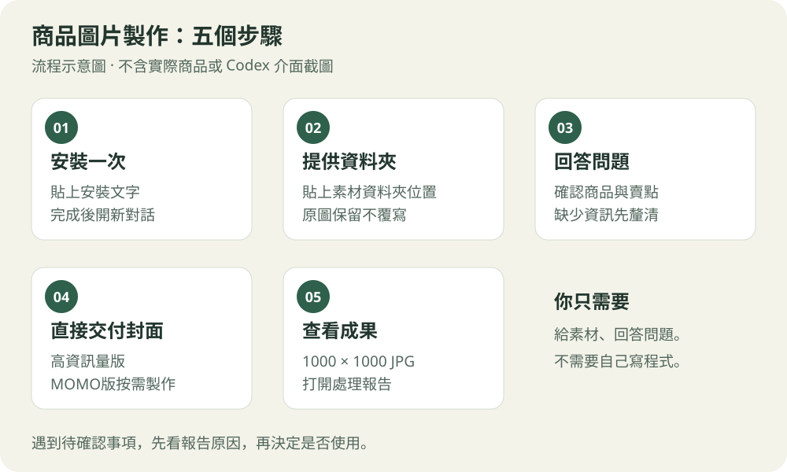

# 商品繁中

給同仁使用的 Codex 技能包。提供商品素材資料夾，由 AI 整理圖片、集中詢問必要資訊，再直接交付高資訊量封面、完整繁中詳情及最多12張的蝦皮S詳情。預設不生成M詳情或MOMO封面，兩項各自明確要求時才製作。

預設保留原風格繁中，明確要求時可採「繁中重設計」，重新安排整套圖文與情境。以戶外商品為主，兼顧旅遊及潮流3C；兩種模式都保留商品事實及完整實質資訊。

固定附上 `主圖詳情頁差異預覽.html`：左側原始檔、右側重製版本，各自上下捲動、跳圖及適寬／100%檢視，並可切換主圖與詳情頁。兩側保留各自的排序與張數，方便美編核對重排、文案與商品外觀；整份成果資料夾可離線開啟。



## 安裝一次

打開桌面版 Codex，選擇本機執行，將下面整段貼到對話送出：

```text
請使用 $skill-installer，從 GitHub 倉庫 Keith0512/product-image-workflow 的 main 分支，一次安裝這三個技能：
skills/product-image-workflow
skills/product-cover
skills/shopee-image-batch
若有同名技能，先保留並比較差異，不直接覆蓋。完成後請檢查三個技能是否可讀。
```

完成後開新對話；若找不到技能，重新開啟 Codex。

## 更新已安裝的技能

已安裝過的電腦，可在本機執行的 Codex 貼上：

```text
請使用 $skill-installer，將 GitHub Keith0512/product-image-workflow 的 main 最新版更新到本機這三個技能：
skills/product-image-workflow
skills/product-cover
skills/shopee-image-batch
這次已授權更新既有同名技能：先下載到暫存目錄，比較差異，將舊版完整備份到技能掃描範圍以外，再以 main 版本更新；未安裝的就直接安裝。
不要因同名目錄存在就停止，也不要改動其他技能、Codex 設定或商品素材。
完成後檢查三個 SKILL.md、參考文件與腳本可讀，並確認：
1. 蝦皮 S 詳情的寬高比為「寬÷高」，須介於0.5～32（含邊界）；維持寬1000像素、整數高度32～2000像素、最多12張、每張≤2,000,000 bytes。
2. 商品繁中第二輪預設直接交付高資訊量封面、完整3版與S版，不再要求選稿。M詳情與MOMO封面預設不生成，只有明確要求對應項目時才各自啟用；未啟用不建資料夾、不判缺件，也不要求確認N/A。
3. 同時保留分割前視覺驗收、check-visual及已啟用M的驗收；完整稽核預設不要求M，有要求M時可用--include-m或--mode m。
4. 明確要求MOMO封面時，仍保留momo-cover.md與check_momo_jpeg.py的版面及實際YCbCr檢核，且MOMO封面不套浮水印。
5. 預設仍走原風格繁中；明確要求時才採繁中重設計。入口的references/redesign.md、redesign-prompts.md、redesign-examples.md及category-guidance.md可讀，兩個子技能能沿用共用摘要、商品不變項與整套視覺設定；戶外、旅遊與潮流3C指引不改寫商品事實。
6. 直式詳情先規劃完整連續敘事：品牌Logo與完整品名集中首屏，尾屏按需一次；中段只保留必要的短主題，不反覆出現品牌海報開場。主圖／選項可獨立識別，商品實體印刷Logo照留。
7. 多商品固定逐一完成：可先整批盤點與集中問答，但每個商品本次要求的全部產出與必要驗收完成後，才自動開始下一個；待確認或驗收未通過就停在當前商品，不自動跳過或跨商品並行。
8. 固定產出主圖詳情頁差異預覽.html，左原稿、右最終稿，各自上下捲動／跳圖／適寬與100%檢視，主圖與詳情可切換。入口的references/comparison-preview.md、scripts/build_compare_preview.py及assets/compare-preview.html可讀；固定交付與實際瀏覽器驗收不得省略。
回報來源 commit、安裝位置、備份位置與驗證結果；這次只更新技能，不處理商品。
```

更新後下一輪即可使用；若仍看不到更新，重新開啟 Codex。GitHub `main` 更新不會自動替換其他電腦的本機技能，需各自執行更新。[技能安裝與變更偵測說明](https://learn.chatgpt.com/docs/build-skills)

## 每次使用

將下面的來源路徑換成你的資料夾，整段貼到 Codex：

```text
請使用「商品繁中」技能（$product-image-workflow）完整製作商品圖片。
來源目錄：D:\商品素材\商品A
先讀主圖、詳情圖、規格圖與選項圖，再集中問我必要問題。
第一輪集中確認商品特色及必要活動資訊，第二輪直接交付高資訊量封面，不用等我選稿。
蝦皮S詳情維持寬1000像素，寬÷高須介於0.5～32（含邊界），最多12張；保留完整繁中3版。
預設不生成M詳情或MOMO封面；只有我明確要求對應項目時才製作。
封面與主圖交付 1000 × 1000 JPG，保留所有原始素材。
固定附上主圖詳情頁差異預覽.html，方便美編左右核對原稿與重製版本。
```

資料夾名稱不用完全一致；沒有選項圖或規格圖，就直接告訴 AI。

多商品可提供包含各商品子目錄的總資料夾。AI可先整批盤點與集中問答，再依商品目錄自然排序，完成一個商品本次要求的全部產出及必要驗收後，自動處理下一個；各商品在同次輸出版本內分目錄保存成品與報告。當前商品待確認或驗收未通過時先停留；只有明確指定才改序、跳過或跨商品並行，不增加逐商品批准步驟。

### 選擇製作模式

| 模式 | 如何使用 |
|---|---|
| 原風格繁中（預設） | 沿用現在的封面流程；批次圖片保留原構圖、風格及閱讀順序，完成繁中與必要修整。未指定時直接使用，不額外詢問 |
| 繁中重設計 | 明確要求後，從原廠事實與買家情境規劃畫面證據，再安排構圖、繁中排版及整套視覺；依任務選參考圖編輯或原商品區域合成，核對商品身份與規格 |

需要重設計時，在上述工作指令加上實際需求，例如：

```text
製作模式：繁中重設計。
商品情境：戶外露營；請依素材安排封面、功能情境及規格／套組的閱讀順序。
本次允許封面與詳情生成或替換背景，商品結構、顏色、Logo及配件保持來源。
沿用集中問答後直接交付的流程，不用另外等我選稿。
```

戶外可以依商品採森林機能、明亮家庭露營或輕量登山等方向；旅遊著重攜帶與使用便利，潮流3C著重材質、造型及相容性。跨類別商品可結合重點，例如戶外電源同時交代露營情境與供電規格。類別不會自動套上未證實的性能或固定背景。

重設計先把「原廠事實 → 買家利益 → 畫面證據」排成逐圖企劃，每張提示詞都帶入商品不變項及共同視覺設定；原廠商品圖提供身份與結構依據，已驗收的風格參考只提供美術語言。共用模板與兩個 GitHub 技能的方法來源、固定版本見 [共用提示詞與視覺一致性](skills/product-image-workflow/references/redesign-prompts.md)，露營與3C的判斷例子見 [合格／退稿範例](skills/product-image-workflow/references/redesign-examples.md)。

主圖與選項可各自呈現品牌和品名；直式詳情是一條由上往下閱讀的完整敘事，品牌Logo與完整品名集中首屏，尾屏按需一次。中段標題短而承接，也可省略，不把每張輸出圖做成重複品牌開場的海報。整套一致性由字體、色調、照片、間距與閱讀節奏維持；商品本體上的實體Logo照留，不要求跨頁風景強行拼接。

只提供風格參考不會自動切換模式。只有明確說「兩套都要」才同時製作，分別放在本次版本下的`原風格繁中/`及`繁中重設計/`，各有自己的成果及報告。重設計仍保留完整3版與S內容，M詳情及MOMO封面依明確要求各自啟用。

主圖與詳情整理好後，AI 必須先逐張檢查字體大小、排版，以及不該有的陰影、鬼影、殘影；有問題先修正並重新檢查。全部通過後才製作S及明確啟用的M詳情，改圖後需重新驗收；紀錄與修正前後對照會放進處理報告。這是 AI 的必要檢查，不需要你每張例行確認。

預設將所有成品、草稿、中間檔及報告存入 `D:\商品素材\商品A\輸出\YYYYMMDD-v01\`；日期採使用者時區，同日再次製作使用 v02、v03，保留原圖與歷史版本。需要另存時，再指定輸出位置。

高資訊量封面存為 `1_主圖/主圖_01.jpg`。蝦皮S詳情固定寬1000像素，寬÷高介於0.5～32（含邊界，即整數高度32～2000像素），最多12張、每張≤2,000,000 bytes；依完整段落與照片安全切割。無法同時兼顧清晰度、完整內容與12張限制時，保留完整3版與作業稿並標REVIEW。

只有明確要求時才另製M詳情或MOMO封面，兩者獨立。M詳情啟用後預設為20頁內、每頁1000×1500的必要資訊編輯版，完整內容保留於3版；明確要求只切不改時才使用完整固定1500像素切片。MOMO封面另存 `8_MOMO專用/主圖_01.jpg`，採用 [官方廣告用圖規範](https://rules.momo.com.tw/goods/00021/) 的版面限制，另檢查最終JPEG的實際YCbCr編碼；解碼後顯示RGB不能代替此項檢核。未啟用的M詳情與MOMO封面不建立資料夾，也不列為缺件。

需要浮水印時，啟動時一併提供圖檔或本機路徑，透明 PNG 優先。每個指定浮水印各做一套一般主圖（預設包含高資訊量封面），右下角優先並避開重要內容，先各看一張樣張再整批套用。無浮水印版保留在 `1_主圖`，各套放 `7_浮水印主圖/店家或品牌名稱/`；也可指定只套高資訊量封面。`8_MOMO專用` 不套浮水印。未提供浮水印就沿用一般流程。

**第一次使用請看 [圖文操作說明](docs/quickstart.md)。** 不需自行寫程式；AI 會先檢查工具，缺少能力時須回報。

## 套件分工

| 中文名稱 | 技能識別名稱 | 工作 |
|---|---|---|
| 商品繁中 | `product-image-workflow` | 統一入口、選製作模式及商品情境、共用問答與視覺摘要、整合交付 |
| 商品封面 | `product-cover` | 沿用原流程或共用重設計風格，入口交接直接交付高資訊量封面；MOMO封面按需製作及檢核YCbCr，單獨使用可選稿 |
| 商品圖批次處理 | `shopee-image-batch` | 原風格繁中或按需重設計、完整3版、最多12張蝦皮S詳情與報告；M詳情按需製作 |

可單獨指定「只做封面」「只做批次圖片」或「只重做M版」。M版是本套件的可選詳情輸出，交付規格不代表momo平台最新規範。

## 使用條件

- 使用能讀寫本機資料夾、檢視圖片及執行程式的 Codex 環境。封面還需要生圖能力；完整繁中處理需要 OCR、字型、排版及背景修復工具。
- 技能不附模型、API 金鑰或 OCR 服務。批次腳本需要 Python 3.10+ 與 Pillow；必要時請 Codex 在專用環境準備，避免改動共用環境。
- 安裝需要 GitHub 網路連線；生圖及部分 OCR 工具可能需要網路。技能不會自動上架，也不會自動把素材推送到 GitHub。素材是否傳送至 AI 服務，依實際使用工具而定。
- 沒有通過文字、外觀與檔案檢查的圖片，不得當作完成品。

本倉庫供同仁取得與安裝，暫未提供開源授權。商品原圖、手作封面與實際處理成果均不隨套件公開。
