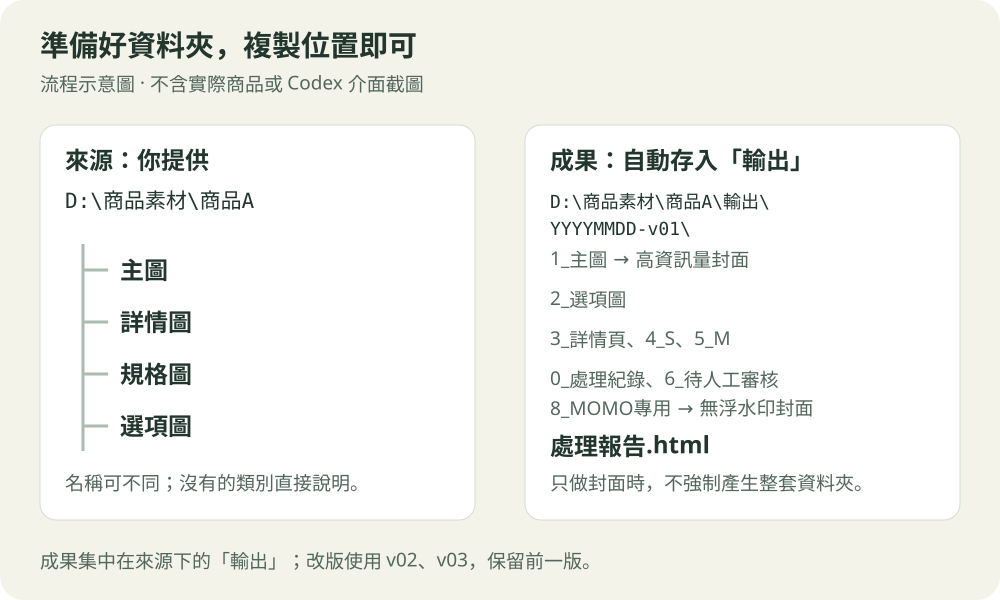

# 第一次使用：照著做就好

這是給第一次使用 Codex 的同仁看的操作說明。下方圖片都是**流程示意，不是 Codex 介面截圖**；不包含實際商品素材。

## 1. 打開 Codex

沒有安裝桌面程式時，先依 [OpenAI 官方 Windows 說明](https://learn.chatgpt.com/docs/app/windows)下載、安裝並登入。打開程式，從模式選單選 **Codex**，執行位置選 **本機／This computer／Local**。介面名稱可能隨版本不同。

這裡的「技能」是讓 AI 照既定工作流程做事的一組說明，不需要你自行寫程式。

## 2. 安裝技能包

開新對話，複製 [首頁「安裝一次」](../README.md#安裝一次)的整段文字，貼進對話並送出。等 AI 回覆三個技能的安裝結果，再開新對話使用。

看到同名技能已存在時，讓 AI 比較差異並說明；不要為了重新安裝就刪掉原本的技能。不同電腦要各自確認安裝狀態。

已安裝過、要取得新版時，改貼 [首頁「更新已安裝的技能」](../README.md#更新已安裝的技能) 的整段指令。它會先下載、比較及備份，再更新三個同名技能；只更新 GitHub 不會自動更新其他電腦。

找不到技能時，先重開 Codex，再貼：

```text
請確認 product-image-workflow、product-cover、shopee-image-batch 是否已安裝且可以讀取，先不要處理商品。
```

## 3. 準備圖片與資料夾位置



把同一商品的主圖、詳情圖、規格與款式圖放進一個目錄。可以有子資料夾，也可以混放；不同商品請分開。沒有某一類圖片就直接說明，不必為了配合範例建立空資料夾。

在 Windows 檔案總管打開商品資料夾，按上方地址列，複製完整位置。只要提供來源，例如 `D:\商品素材\商品A`，AI 就會在下方新增 `輸出\YYYYMMDD-v01\`，存放這次所有成品、草稿、中間檔及報告。日期採使用者時區，同日改版使用 v02、v03，保留前一版；掃描素材時會排除「輸出」資料夾。需要另存時，再指定其他輸出位置。

多商品批次可提供包含各商品子目錄的總資料夾。AI可先整批盤點與集中問答，之後依商品目錄自然排序，完成並驗收一個商品的全部要求產出，再自動做下一個；成品與報告在同次輸出版本內按商品分目錄。當前商品待確認或驗收未通過時，先停在該商品，不自行跳過；只有你明確指定才改序、跳過或跨商品並行，也不新增逐商品批准步驟。

## 4. 貼上工作指令

複製 [首頁「每次使用」](../README.md#每次使用)的文字，換成你的來源位置後送出。第一次可以先只做一個商品。完整流程叫「商品繁中」；只做封面可叫「商品封面」，只處理繁中圖片與詳情切片可叫「商品圖批次處理」。

未指定製作模式時，沿用「原風格繁中」：保留現有封面流程，批次圖片保留來源風格。需要整套重新後製時，明確加上「製作模式：繁中重設計」，並說明希望的情境；若有限制只用原照、不可生圖或只改封面背景，再一併指定。可直接套用[首頁重設計範例](../README.md#選擇製作模式)。已有回答及品牌風格會沿用，維持集中問答後直接交付。

商品以戶外為主，也可處理旅遊與潮流3C。AI依商品用途選情境及內容重點，例如家庭露營、輕量登山、旅行收納或3C相容性；商品分類不會自動改動原風格模式。兩種模式都須保留商品實際外觀、規格、配件與完整實質資訊。

重設計會先規劃每張的購買問題與畫面證據，再套用共用商品條件、字體、色調及照片語氣。主圖／選項可獨立辨識；直式詳情則由上往下連續閱讀，品牌Logo與完整品名集中首屏，尾屏按需一次，中段只用必要的短主題承接，不反覆重做品牌開場。商品本體上的實體Logo保留。

AI 會先整理它看到的圖片與規格，再詢問還不確定的事情。回答重點即可，例如：

```text
這次主推黑色單品，買家是週末露營族。
第一賣點是方便收納；沒有贈品，收納袋是原本內附。
商品結構、顏色與 Logo 都不能改；高資訊量版可以換戶外背景。
```

以上只是回答方式範例，請用實際商品資訊替換。

需要浮水印時，可在啟動時同時提供圖檔、本機路徑，或在素材目錄下放「浮水印」資料夾，並標明各檔案的店家／品牌。透明 PNG 優先；已指定的浮水印會作為輔助素材，不算商品圖。例如：

```text
另有兩張浮水印：店家A.png、店家B.png，各做一套主圖。
一般主圖包含高資訊量封面都套用；如另有要求MOMO專用版，該版不套浮水印。
右下角優先，遮到重要內容時可換位置。
保留無浮水印版本，先各提供一張樣張確認大小、位置與透明度。
```

## 5. 取得高資訊量封面

第一輪會集中確認商品特色與尚未清楚的活動資訊；第二輪直接製作並交付 **1000 × 1000 JPG** 高資訊量封面，不需要選稿：

- **高資訊量版**：呈現已確認的品名、賣點、規格與適用活動。
- **MOMO 專用版（僅明確要求時）**：無壓標、無壓框、無浮水印，採純色背景、商品占比至少 80%，不可有白／黑邊，並實際檢核最終 JPEG 的 YCbCr 編碼。商品原本印刷的文字與 Logo 會保留。

特價、加購優惠、買就送或贈品等資訊併入第一輪問答；有活動才補充品項、金額、幣別與必要條件，已回答的內容不重問。這些文案用於高資訊量封面，MOMO 版不加行銷壓標。

預設不生成MOMO封面，也不生成M詳情；只有明確要求對應項目時才各自啟用。未啟用不需要確認N/A，也不列為缺件。本次要求的成品均需完成檢查後交付；若工具不足或有規格衝突，AI應說明原因。需要改版時，指出版本及要改哪裡，不必重新提供整套素材。單獨使用「商品封面」技能時，仍可採A／B提案選稿流程。

## 6. 找成品與待確認項目

主圖、適用選項圖與詳情整理稿完成後，AI 會先逐張看整體排版與100%局部，檢查字體大小／字重／行距／對齊、舊字殘留，以及修圖造成的多餘陰影、鬼影、殘影。有問題會先修正並複檢，全部通過後才開始S及明確啟用的M詳情；原本的商品真實投影與主副標層級會保留。無法修好的問題會列出原因並暫停該商品切片，不先切完才檢查，也不要求你每張例行批准。

完整製作完成後，AI 會提供來源下「輸出」內本次版本資料夾、`主圖詳情頁差異預覽.html` 與 `處理報告.html` 的連結。比較頁左側放原始檔、右側放最終重製版本，兩欄可各自上下捲動、跳圖及切換適寬／100%，並可切換主圖與詳情頁；重排後兩側張數可不同。打開報告看圖片、文字、尺寸與待確認項目，再決定哪些可以使用。

比較頁取代舊的單欄 `商品詳情預覽.html`，為商品繁中的固定輸出。搬移時保留同層的 `0_處理紀錄/差異預覽素材`，即可離線開啟；右側完整詳情使用3版，僅封面或僅M等限定任務只列本次適用分類。

單一製作模式沿用下表目錄。只有明確要求原風格及重設計兩套時，才在本次版本下分成`原風格繁中/`及`繁中重設計/`，各自有下表成果及報告，總報告連結兩套。重設計的`0_處理紀錄`另有共用視覺摘要及`重設計內容對照.csv`，可追溯每項資訊的改寫／整併、來源與成品位置。

| 名稱 | 放什麼 |
|---|---|
| `1_主圖` | 高資訊量封面在第一張，其餘一般商品主圖依序排列 |
| `2_選項圖` | 顏色、款式等選項圖片；適用時製作 |
| `3_詳情頁` | 整理、繁中化後的完整內容分段 |
| `4_S詳情頁` | 蝦皮詳情：寬1000、寬÷高0.5～32（含邊界，即整數高度32～2000），最多12張、每張≤2,000,000 bytes |
| `5_M詳情頁` | 僅明確要求時製作；預設20頁內、每頁1000×1500的必要資訊編輯版。只切不改時才完整固定切片，末張保留實際高度 |
| `7_浮水印主圖/店家或品牌名稱` | 每個指定浮水印各一套一般主圖，檔名與原版對應；不包含 MOMO 版 |
| `8_MOMO專用` | 僅明確要求時製作的無浮水印MOMO封面，另列版面與YCbCr檢核結果 |
| `主圖詳情頁差異預覽.html` | 固定交付的左右比較頁；各側獨立捲動、跳圖及縮放，供美編核對原稿與最終稿 |
| `0_處理紀錄`、`6_待人工審核` | 草稿、追溯紀錄與異常圖片；其他中間檔放 `0_處理紀錄/work` |

浮水印素材副本、各套樣張及 `浮水印紀錄.json` 會保存在 `0_處理紀錄`。`1_主圖` 保留無浮水印版，各套各自計算最多 9 張並檢查尺寸與容量；完整製作報告會分套展示。MOMO 版獨立存放，不套浮水印，也不把這套一般主圖的 9 張約定當作 MOMO 平台限制。只做封面時也可交付適用浮水印封面，不要求其他四套圖片。

報告會分列高資訊量封面及批次結果；M詳情與MOMO封面未要求時註明「未啟用」。明確要求MOMO封面時，另列專用版結果，編碼檢核紀錄保存在 `0_處理紀錄`；一般RGB圖片檢查不代替YCbCr檢核，版面、商品占比及保真仍須實際看圖確認。

處理報告會另外列出「分割前視覺驗收」，可以查看每張的檢查結果、修正前後對照與複檢結論。重新改圖後要重新驗收；切片完成後仍會再檢查切線與壓縮品質。

**PASS** 是必要檢查已通過；**REVIEW** 代表還有待確認；**FAIL** 代表缺少必要步驟或成果。報告顯示 REVIEW／FAIL 時，先看原因，不把它當作全部完成。只做封面或只重跑 M 時，不會要求產生整套資料夾。

這套交付尺寸是我們約定的製作規格；實際上架前仍依通路要求確認。

---

官方參考：[技能安裝與使用](https://learn.chatgpt.com/docs/build-skills) · [Codex 本機與雲端環境](https://learn.chatgpt.com/docs/environments/modes)
