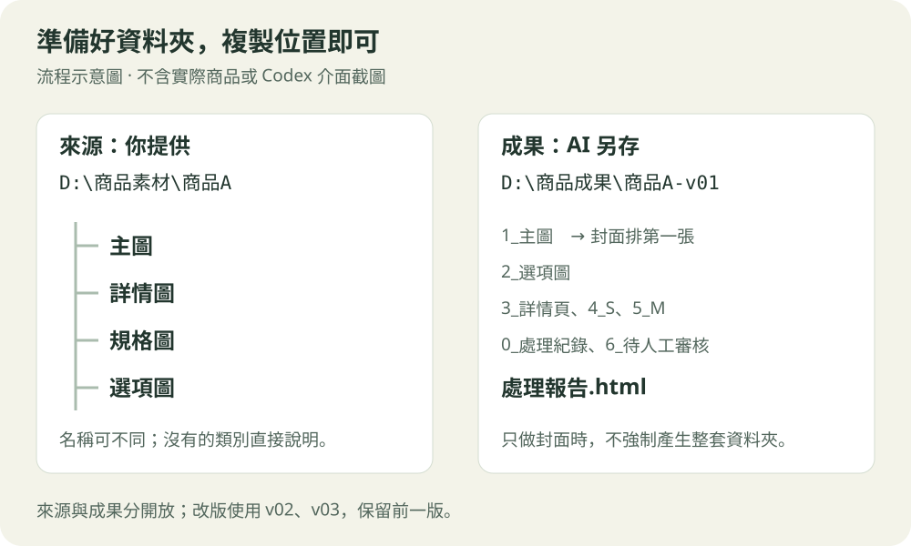

# 第一次使用：照著做就好

這是給第一次使用 Codex 的同仁看的操作說明。下方圖片都是**流程示意，不是 Codex 介面截圖**；不包含實際商品素材。

## 1. 打開 Codex

沒有安裝桌面程式時，先依 [OpenAI 官方 Windows 說明](https://learn.chatgpt.com/docs/app/windows)下載、安裝並登入。打開程式，從模式選單選 **Codex**，執行位置選 **本機／This computer／Local**。介面名稱可能隨版本不同。

這裡的「技能」是讓 AI 照既定工作流程做事的一組說明，不需要你自行寫程式。

## 2. 安裝技能包

開新對話，複製 [首頁「安裝一次」](../README.md#安裝一次)的整段文字，貼進對話並送出。等 AI 回覆三個技能的安裝結果，再開新對話使用。

看到同名技能已存在時，讓 AI 比較差異並說明；不要為了重新安裝就刪掉原本的技能。不同電腦要各自確認安裝狀態。

已安裝過、要取得新版時，改貼 [首頁「更新已安裝的技能」](../README.md#更新已安裝的技能) 的整段指令。它會先下載、比較及備份，再更新三個同名技能；只更新 GitHub 不會自動更新其他電腦。

找不到技能時，先重開 Codex，再貼：

```text
請確認 product-image-workflow、product-cover、shopee-image-batch 是否已安裝且可以讀取，先不要處理商品。
```

## 3. 準備圖片與資料夾位置



把同一商品的主圖、詳情圖、規格與款式圖放進一個目錄。可以有子資料夾，也可以混放；不同商品請分開。沒有某一類圖片就直接說明，不必為了配合範例建立空資料夾。

在 Windows 檔案總管打開商品資料夾，按上方地址列，複製完整位置。只要提供來源，例如 `D:\商品素材\商品A`，AI 就會在下方新增 `輸出\YYYYMMDD-v01\`，存放這次所有成品、草稿、中間檔及報告。日期採使用者時區，同日改版使用 v02、v03，保留前一版；掃描素材時會排除「輸出」資料夾。需要另存時，再指定其他輸出位置。

## 4. 貼上工作指令

複製 [首頁「每次使用」](../README.md#每次使用)的文字，換成你的來源位置後送出。第一次可以先只做一個商品。完整流程叫「商品繁中」；只做封面可叫「商品封面」，只處理繁中圖片與詳情切片可叫「商品圖批次處理」。

AI 會先整理它看到的圖片與規格，再詢問還不確定的事情。回答重點即可，例如：

```text
這次主推黑色單品，買家是週末露營族。
第一賣點是方便收納；沒有贈品，收納袋是原本內附。
商品結構、顏色與 Logo 都不能改，可以換戶外背景。
```

以上只是回答方式範例，請用實際商品資訊替換。

需要浮水印時，可在啟動時同時提供圖檔、本機路徑，或在素材目錄下放「浮水印」資料夾，並標明各檔案的店家／品牌。透明 PNG 優先；已指定的浮水印會作為輔助素材，不算商品圖。例如：

```text
另有兩張浮水印：店家A.png、店家B.png，各做一套主圖。
全部主圖包含封面都套用，右下角優先，遮到重要內容時可換位置。
保留無浮水印版本，先各提供一張樣張確認大小、位置與透明度。
```

## 5. 選封面

AI 會提供 **A 高資訊量**與 **B 簡潔聚焦**兩個方向。等看過草稿，再回覆你的選擇：

```text
我選 B，品名再大一點，保留原本的商品角度。其他不變。
```

選稿時，AI 也會詢問是否有其他商品特色或行銷活動要加入封面，例如特價、加購優惠、買就送或贈品。已回答的資訊不會重問；有活動時再補充品項、金額、幣別與必要適用條件。有新增內容會先更新草稿，讓你確認後再定稿。

選定前不會當作定稿；若工具無法產生草稿，AI 應說明原因。需要改版時，指出要改哪裡，不必重新提供整套素材。

## 6. 找成品與待確認項目

主圖、適用選項圖與詳情整理稿完成後，AI 會先逐張看整體排版與100%局部，檢查字體大小／字重／行距／對齊、舊字殘留，以及修圖造成的多餘陰影、鬼影、殘影。有問題會先修正並複檢，全部通過後才開始S／M詳情切片；原本的商品真實投影與主副標層級會保留。無法修好的問題會列出原因並暫停該商品切片，不先切完才檢查，也不要求你每張例行批准。

完整製作完成後，AI 會提供來源下「輸出」內本次版本資料夾與 `處理報告.html` 的連結。打開報告看圖片、文字、尺寸與待確認項目，再決定哪些可以使用。

| 名稱 | 放什麼 |
|---|---|
| `1_主圖` | 選定封面在第一張，其餘商品主圖依序排列 |
| `2_選項圖` | 顏色、款式等選項圖片；適用時製作 |
| `3_詳情頁` | 整理、繁中化後的完整內容分段 |
| `4_S詳情頁` | 按內容分段的詳情切片 |
| `5_M詳情頁` | 每張固定高 1500 像素，最後一張保留實際高度 |
| `7_浮水印主圖/店家或品牌名稱` | 每個指定浮水印各一套主圖，檔名與原版對應；有啟用時才產生 |
| `0_處理紀錄`、`6_待人工審核` | 草稿、追溯紀錄與異常圖片；其他中間檔放 `0_處理紀錄/work` |

浮水印素材副本、各套樣張及 `浮水印紀錄.json` 會保存在 `0_處理紀錄`。`1_主圖` 保留無浮水印版，各套各自計算最多 9 張並檢查尺寸與容量；完整製作報告會分套展示。只做封面時也可交付各套封面，不要求其他四套圖片。

處理報告會另外列出「分割前視覺驗收」，可以查看每張的檢查結果、修正前後對照與複檢結論。重新改圖後要重新驗收；切片完成後仍會再檢查切線與壓縮品質。

**PASS** 是必要檢查已通過；**REVIEW** 代表還有待確認；**FAIL** 代表缺少必要步驟或成果。報告顯示 REVIEW／FAIL 時，先看原因，不把它當作全部完成。只做封面或只重跑 M 時，不會要求產生整套資料夾。

這套交付尺寸是我們約定的製作規格；實際上架前仍依通路要求確認。

---

官方參考：[技能安裝與使用](https://learn.chatgpt.com/docs/build-skills) · [Codex 本機與雲端環境](https://learn.chatgpt.com/docs/environments/modes)
